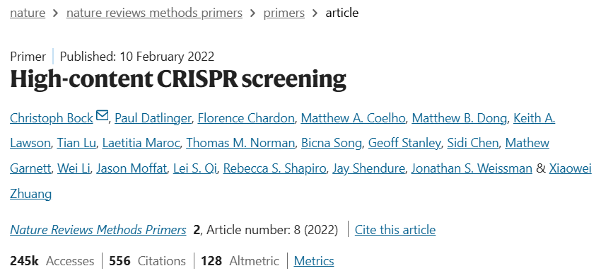
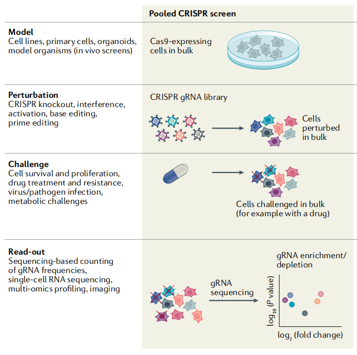
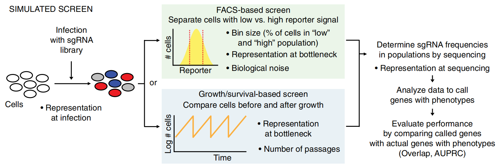
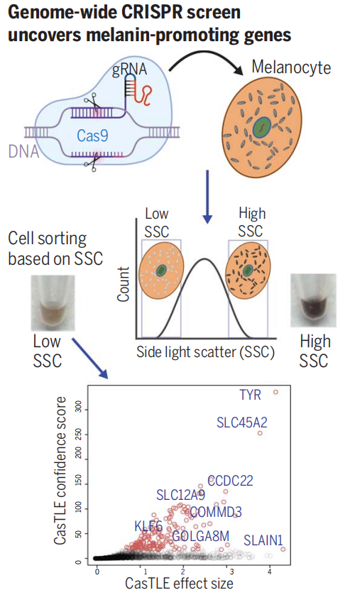

# 0-什么是CRISPR screening？

作者 · 不加酵母的面团（DoughWithoutYeast）

原发表于 2026-06-23 · [博客园原文](https://www.cnblogs.com/DoughWithoutYeast/p/20745282)

原文更新于 2026-08-19

\
这篇文献`https://www.nature.com/articles/s43586-021-00093-4`很好地阐述了目前的筛选模式，分析软件和应用前景。非常值得一看。

# CRISPR screening概念

\
我们可以通过提前对基因设计多个靶向它的sgRNA的文库，将这个文库以低MOI的浓度感染进细胞内，以实现对每个细胞感染进一个sgRNA，对不同的细胞敲除/敲低不同的基因。随后观测readout对细胞进行分群，比较可以sgRNA的富集或耗竭，进而推断其靶向的基因的功能。

以最简单的必需基因的筛选举例。\
当我们的sgRNA靶向的基因是细胞增殖的必需基因时，则感染了这些sgRNA的细胞将会由于缺失必需基因而死亡。因此，将感染后未传代的细胞与传代后的细胞比较，得到sgRNA的丰度。那些耗竭的sgRNA所靶向的基因更有可能是被负选择的基因，而富集的sgRNA所靶向的基因则更有可能被正选择。被正选择的基因是非必需的，被负选择的基因是必需基因。\
这就类似，当P53基因某个重要的功能结构与突变的个体很有可能不能存活，因为P53这个功能结构域过于重要！

# readout有什么？

对于筛选来说最重要的就是构建一个readout对细胞进行分群，通过比较两群细胞的sgRNA丰度的改变推断其靶向基因的功能和方向。像上面提到的必需基因的筛选，则是通过增殖表型进行对细胞【见上图下方模式】，还有一种被广泛应用的思路是，通过流式细胞仪对表达报告基因的细胞进行筛选【见上图上方模式】。\
基于分选的筛选则大大地扩展了筛选的应用范围。\
\
`A genome-wide genetic screen uncovers determinants of human pigmentation`例如这篇文献就是通过对细胞的吸光度来表征黑色素的含量，对细胞进行分选。想象一下，对任何已知报告基因的过程，我们都可以进行类似的筛选。可以扩展变式到形形色色的生物学过程。可以筛选出直接或间接的，高内含，生物信息丰富的各种作用因子。也可以对细胞进行提前处理，例如加药处理或者是预先敲除某个基因，或者是构建某个突变的细胞系，再进行筛选，又可以筛选到context-specific的作用因子！

# CRISPR screening的应用前景

就像前文说到的，只要设计出合理的readout，筛选具有无限的潜能！\
不仅仅是readout可以有多种变式，文库也可以有多种多样的类型。敲低、敲除、敲入等，甚至可以发展成对RNA的编辑或者是表观组的编辑。同时对细胞系的研究也可以进化到类器官、在体。从混池测序也可以进化到单细胞的测序。

因此，对于生物人来说，掌握CRISPR screening的里面和技术是至关重要的！\
本合集将从生信的角度解读screening，从原理到分析一步步探索其中蕴含的丰富生物学信息！

---

[合集目录](README.md) · [下一篇](01-mageck-analysis.md)
