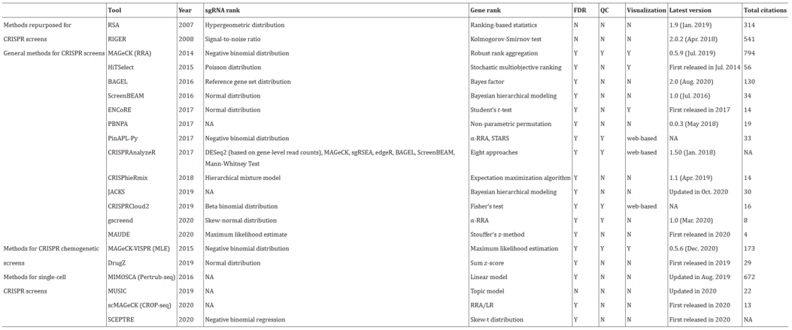
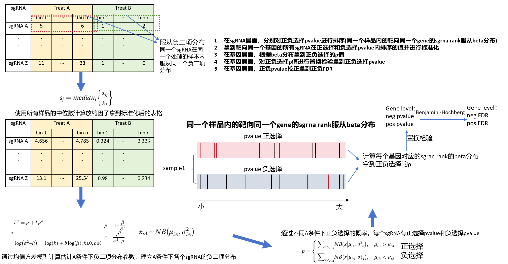

# 1-使用MAGeCK分析pooled CRISPR screening数据

作者 · 不加酵母的面团（DoughWithoutYeast）

原发表于 2026-06-25 · [博客园原文](https://www.cnblogs.com/DoughWithoutYeast/p/20746147)

原文更新于 2026-08-19

标签 · CRISPR screening

前面我们介绍了CRISPR screening以及其多种变式，今天我们聚焦在pooled CRISPR screening，即对分选或者是不同处理下的两群细胞分别进行bulk测序。然后通过将序列比对到sgRNA上，对sgRNA进行定量。随后通过比较和检验查看sgRNA丰度和富集耗竭情况。\[[https://www.cnblogs.com/DoughWithoutYeast/articles/20745282](00-crispr-screening-intro.md)\]\
这里我们主要使用MAGeCK这个软件。该软件是，刘小乐教授团队开发的。该软件是目前使用最多最权威的软件。同时它有详细的教程和帮助文档以及论坛。最后它不断更新迭代，推出了多个衍生的软件。\


MAGeCK文献：`MAGeCK enables robust identification of essential genes from genome-scale CRISPR/Cas9 knockout screens`\
MAGeCK官网：`https://sourceforge.net/p/mageck/wiki/Home/`

MAGeCK主要建模的原理是：\


# 0-安装MAGeCK

我的习惯是，在conda中创建一个专用于MAGeCK的环境，其中包含了这个分析所需要的各种软件。

```bash
mamba create -n mageck -c bioconda -c conda-forge mageck fastqc multiqc
```

随后当我需分析数据的时候我会提前激活这个环境。

# 1-MAGeCK部分

## （1）数据基本质控

这一步其实是很多人都忽略的，但这一步确实非常之重要！\
这里我主要关注的数据下载的完整性，另外就是fastq文件的质量。\
将下面的代码保存成`check_md5.sh` 放在你数据存储的位置:

```bash
#!/bin/bash
# 遍历当前目录下所有 .fq.gz 文件
for fq_file in *.fq.gz; do
    # 检查对应的 .md5 文件是否存在
    md5_file="${fq_file}.md5"
    if [[ -f "$md5_file" ]]; then
        # 计算当前 .fq.gz 文件的 MD5 值
        computed_md5=$(md5sum "$fq_file" | awk '{print $1}')
        # 读取 .md5 文件的内容
        file_md5=$(head -n 1 "$md5_file" | awk '{print $1}')
        # 比较两者是否一致
        if [[ "$computed_md5" == "$file_md5" ]]; then
            echo "YEAH MD5 matches for $fq_file"
        else
            echo "OPS MD5 mismatch for $fq_file"
            echo "Computed: $computed_md5"
            echo "Expected: $file_md5"
        fi
    else
        echo "！！！！！！！！！！！！！！ MD5 file missing for $fq_file"
    fi
done
```

这个脚本可以对文件所在的目录下遍历所有`fq.gz`寻找对应的`.md5`文件，并比对`fq.gz`文件的md5码是不是与`.md5`相匹配。

```bash
cd /path/to/fastq/data/
bash check_md5.sh
mkdir ./fastqc/
ls ./*fq.gz | xargs fastqc -t 12 -o ./fastqc/ 
multiqc ./fastqc
```

这里可以检查md5码的同时还对fastq文件进行了基本的质控，这里我们可以看到fastq文件的测序质量等信息，我们需要着重关注的是重复序列这个信息。倘若这里有高频出现的reads，那很有可能是文库或者是细胞污染了！

## （2）count-将fastq文件比对到文库数据中

正式进入MAGeCK部分。count实则就将fastq文件比对到文库内。

### （2.1） 构建输入文件

输入文件：

* fastq文件
* 文库文件
* non-targeting文件

一般而言，这样的数据会需要比对的文库信息。我们需要整理成MAGeCK可以识别的样子，like:

```
HGLibA_00001,GTCGCTGAGCTCCGATTCGA,A1BG
HGLibA_00002,ACCTGTAGTTGCCGGCGTGC,A1BG
HGLibA_00003,CGTCAGCGTCACATTGGCCA,A1BG
```

这样的csv格式，或者是用`\t`分隔的txt文件。**注意这里不能有列名列，也不可以quote出来！**\
如果我们后续需要使用non-targeting的方法进行标准化的话，我们还需要构建non-targeting的id文件：

```
HGLibA_64384
HGLibA_64385
HGLibA_64386
```

**注意这里给的是sgRNA的id**

### （2.2）run count

#### code

```bash
mageck count \
 -l /path/to/your/library.csv \ # 刚刚我们构建好的library文件
 --sample-label a,b,c,d \ # 输入你的样本的名称，要和下面尽量保持一致
 --fastq \ # 输入第一reads
 /path/to/your/a_1.fq.gz \
 /path/to/your/b_1.fq.gz \
 /path/to/your/c_1.fq.gz \
 /path/to/your/d_1.fq.gz \
 --fastq-2 \ # 输入第二reads
 /path/to/your/a_2.fq.gz \
 /path/to/your/b_2.fq.gz \
 /path/to/your/c_2.fq.gz \
 /path/to/your/d_2.fq.gz \
 -n demo\ # 你的输出文件的前缀
 --norm-method control\ #指定标准化方法为用non-targeting sgRNA标准化
 --control-sgrna /path/to/your/control_sgRNA_list.txt #指定用control标准化时需要传入non-targeting sgRNA id文件
```

相关参数说明:

| 参数 | 意义 |
| --- | --- |
| -l library.txt | 我们刚刚建立好的library文件 |
| -n demo | 我们想要的输出的文件的前缀 |
| --sample-label L1,CTRL | 我们的样品的名称，这个名称需要和sample的数量保持对应，类似我们的demo中有4个sample，分别是a,b,c,d，就需要4个label |
| --fastq --fastq-2 | 指定fastq文件路径，双端测序需要指定两个fastq文件路径 |

其余参数可以参考详细文档！\
将上面的文件修改成你的路径就可以运行了\~

#### output

| 输出文件名称 | 文件内容 |
| --- | --- |
| demo.count.txt | 输出的每个sgRNA的count文件，未标准化 |
| demo.count\_normalized.txt | 输出的标准化后的sgRNA count文件 |
| demo.count\_report.Rmd | 没啥大用的文件 |
| demo.countsummary.txt | count时文库质控文件和整体总结文件，我们后续需要关注percentage和gini index |
| demo.log | count的日志文件，其中包含了去接头长度等信息 |
| demo\_countsummary.R | 没啥大用的文件 |
| demo\_countsummary.Rnw | 没啥大用的文件 |
| demo\_countsummary.tex | 没啥大用的文件 |

**这里需要注意的点有：**

1. count内默认的标准化方法时`media`
2. 标准化方法指定是`control`时需要输入non-targeting sgRNA id的信息
3. label命名最好易于区分，且信息完整避免后续出现颠倒或错误

**总结一下数据评估主要的两个方面**

* fastqc看测序质量
  + 重复度高正常
  + 测序质量应该合格
  + GC含量异常也属于正常
  + 重复的reads比例过高很有可能是污染了
* mageck count summary看sgRNA覆盖度等
  + percentage看的是所有测序的reads内比对到文库的reads的比例。按文库的设计，只有完全是sgRNA的才会被加上接头并在后续测序中被测到，而测序结果非library sgRNA就可能存在错配或其他错误导致。一般来说**percentage不低于60%视为合格**
  + GiniIndex，基尼系数，评估sgRNA的均一性。越大则sgRNA分布越不均一，即少部分sgRNA承担了绝大多数的reads。**对照组＜0.1，处理组在0.2-0.3是合格的**

## （3）test-对每个gene进行检验

### code

```bash
mageck test \
-t a \ #处理组的label
-c b \ #对照组的label
-k demo.count_normalized.txt \ # count输出的标准化文件
--norm-method none\ #标准化方法
-n demo_test #输出文件前缀
```

相关参数说明：

| 参数 | 意义 |
| --- | --- |
| -t | 处理组label，这个label要和我们count时的label保持一致，注意不要sample颠倒了 |
| -c | 对照组label |
| -k | count文件，这里可以输入原始未标准化的count文件，后续再指定标准化方法，或者直接输入标准化后的count文件并指定标准化方法为`none` |
| -n | 输出文件的前缀 |

其余参数参考详细文档\~

### output

输出文件说明

| 输出文件名称 | 文件内容 |
| --- | --- |
| SR2.gene\_summary.txt | gene水平的检验文件，其中包含LFC等信息，后续我们分析关注的主要文件 |
| SR2.log | 日志文件，not that important |
| SR2.R | 没啥大用的文件 |
| SR2.report.Rmd | 没啥大用的文件 |
| SR2.sgrna\_summary.txt | sgRNA水平的检验文件 |
| SR2\_summary.Rnw | 没啥大用的文件 |

---

**到目前为止MAGeCK的工作就结束了，后续我们可以根据其分析结果进行可视化及其他下游分析了！(to be continue)**

---

[合集目录](README.md) · [上一篇](00-crispr-screening-intro.md) · [下一篇](02-mageck-qc-visualization.md)
