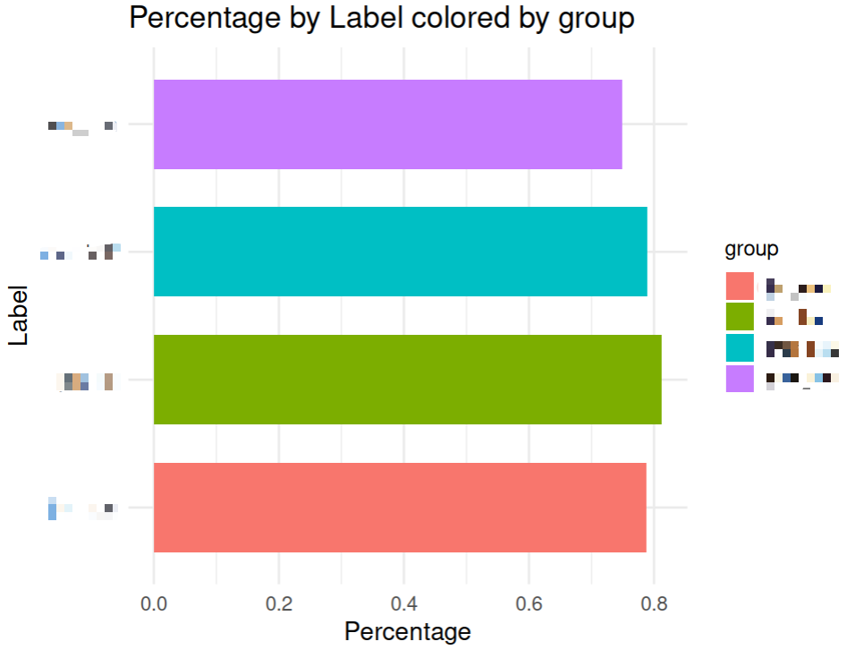
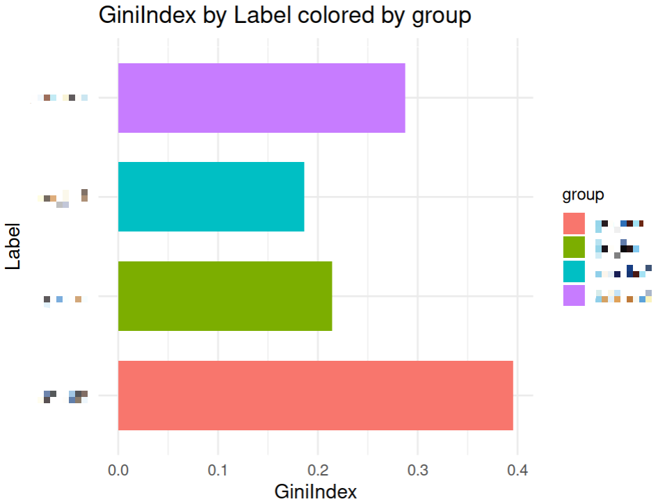
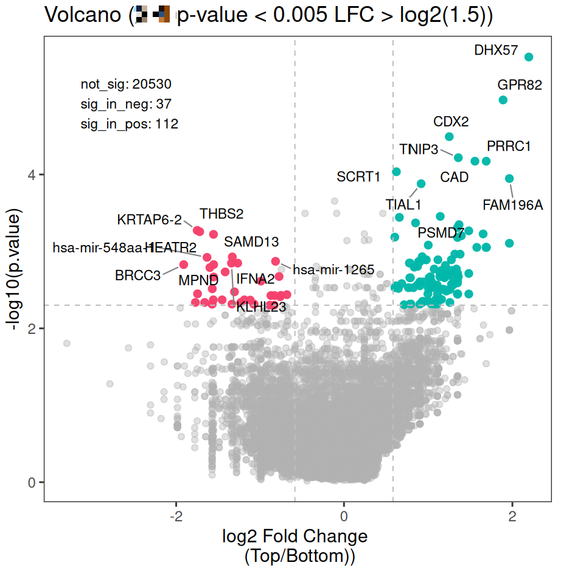

# 2-MAGeCK下游质控和可视化结果

作者 · 不加酵母的面团（DoughWithoutYeast）

原发表于 2026-08-19 · [博客园原文](https://www.cnblogs.com/DoughWithoutYeast/p/20760163)

原文更新于 2026-10-26

标签 · CRISPR screening

## 下游基本分析

### 1.文库质控

文库质控主要是看`MAGeCK count`模块下输出的文件`*.countsummary.txt`内的指标\
我们主要关注的是`Percentage`和`GiniIndex`这两指标。

* Percentage：代表的是所有测到的reads内可以和文库内的序列比对上的比例。可以认为是建库的有效率。当建库失败时，这个比例将非常低，可能是文库扩增或转染时出现错误。如果fastqc报告中没有现实测序质量的报错那就很有可能是实验中引入的错误。**作者认为这个比例需要高于60%**
* GiniIndex：代表文库的均一度，即测到的sgRNA的count是否均一。一般认为未分选或者是原始文库的均一度需要低于0.1，而分选或者处理之后的均一性需要在0.2\~03之间。均一性不易过高，因为一般认为真正起作用的sgRNA仅占少数，若均一性过高可能需要考虑的问题是筛选条件过于强烈或者是PCR时存在的强烈GC bias

<details>
<summary>可视化countsummary结果</summary>

```r
summary <- read.delim('/path/to/your/demo.countsummary.txt')
# summary可视化
plot_sum <- function(df,
                     column,
                     group_var = "Label",
                     palette = NULL) {
  if (!column %in% colnames(df))
    stop(paste("列", column, "不存在！"))
  
  p <- ggplot(df, aes_string(
    x = group_var,
    y = column,
    fill = group_var  # 按分组变量填充颜色
  )) +
    geom_col(position = position_dodge(width = 0.8), width = 0.7) +
    coord_flip() +
    labs(x = group_var,
         y = column,
         title = paste(column, "by", group_var)) +
    theme_minimal(base_size = 14) +
    theme(
      legend.position = "right",
      legend.title = element_text(size = 12),
      legend.text = element_text(size = 10)
    )
  # 添加自定义颜色逻辑
  if (!is.null(palette)) {
    # 检查颜色数量是否匹配分组数
    n_groups <- length(unique(df[[group_var]]))
    if (length(palette) < n_groups) {
      warning("自定义颜色数量少于分组数，将循环使用颜色")
      palette <- rep(palette, length.out = n_groups)
    }
    p <- p + scale_fill_manual(values = palette)
  }
  
  return(p)
}
plot_sum(summary, 'Percentage')
plot_sum(summary, 'GiniIndex')
```

</details>

这里需要指定的参数有：

* summary数据
* 需要绘制的结果，这里我们主要关注percentage和gini index

结果展示：

* percentage\
  
* gini index\
  

PS：我码掉了我的sample信息

### 2.样品质控

样品质控我们主要通过样品之间的相关性热图和PCA降维聚类散点图来评估。注意，如果数据不含生物学重复，则这两个方面没有什么参考价值，因为我们做相关性热图和PCA降维聚类图主要是看生物学重复的相关性和相似性。

<details>
<summary>相关性热图</summary>

```
# 相关性热图
plot_correlation_heatmap <- function(data) {
  library(corrplot)
  count_matrix <- as.data.frame(data)
  rownames(count_matrix) <- count_matrix$sgRNA
  count_matrix <- count_matrix[, -c(1, 2), drop = FALSE]  # 去掉 id 列
  
  # 确保所有列是 numeric 类型
  count_matrix <- as.data.frame(lapply(count_matrix, function(x)
    as.numeric(as.character(x))))
  rownames(count_matrix) <- rownames(data)
  
  # 去除全为 NA 的列
  count_matrix <- count_matrix[, colSums(is.na(count_matrix)) < nrow(count_matrix), drop = FALSE]
  
  # 计算相关矩阵
  cor_matrix <- cor(count_matrix, method = "spearman", use = "pairwise.complete.obs")
  
  # 绘制热图
  corrplot(
    cor_matrix,
    method = "color",
    type = "upper",
    tl.col = "black",
    tl.srt = 45,
    addCoef.col = "white",
    number.cex = 0.7
  )
}
plot_correlation_heatmap(count)
```

</details>

结果展示：
!\[image\](https://img2024.cnblogs.com/blog/3805523/202607/3805523-20260706211117922-1471566862.png)

<details>
<summary>PCA降维聚类图</summary>

```#
plot_PCA <- function(data, title) {
  library(dplyr)
  library(ggplot2)
  library(ggrepel)
  
  expr_mat <- data %>%
    select(-Gene, -sgRNA) %>%
    as.data.frame()
  
  # 行名设为 sgRNA
  rownames(expr_mat) <- data$sgRNA
  
  # Step 1: 过滤全0/恒定基因
  expr_mat_filtered <- expr_mat %>%
    filter(apply(., 1, function(x)
      length(unique(x)) > 1))
  
  # Step 2: PCA分析
  pca_res <- prcomp(t(expr_mat_filtered), scale. = TRUE)
  
  # Step 3: 整理PCA结果
  pca_df <- data.frame(
    Sample = colnames(expr_mat_filtered),
    PC1 = pca_res$x[, 1],
    PC2 = pca_res$x[, 2]
  )
  
  # Step 4: 绘图
  ggplot(pca_df, aes(x = PC1, y = PC2, color = Sample)) +
    geom_point(size = 4) +
    geom_text_repel(
      aes(label = Sample),
      size = 3,
      max.overlaps = Inf,
      segment.color = "gray50",
      segment.size = 0.5
    ) +
    labs(
      title = title,
      x = paste0("PC1 (", round(summary(pca_res)$importance[2, 1] * 100, 1), "% variance)"),
      y = paste0("PC2 (", round(summary(pca_res)$importance[2, 2] * 100, 1), "% variance)"),
      color = "Sample"
    ) +
    theme_minimal() +
    theme(legend.position = "right")
}

plot_PCA(count, NULL)
```

</details>

结果展示：
!\[image\](https://img2024.cnblogs.com/blog/3805523/202607/3805523-20260706211156020-1172508008.png)
像是这里，质粒的举例就比我的处理后的相互之间更加接近。

### 3.重复性评估

这里我们主要是看的sgRNA在不同的生物学重复之间的标准化count的重复性。用颜色深浅来表示sgRNA密度。

<details>
<summary>点击查看代码</summary>

```
plot_repeatability_log10 <- function(data, item_1, item_2,title) {
  
  data_filtered <- data %>%
    filter(.data[[item_1]] + .data[[item_2]] > 10)
  
  data_log <- data_filtered %>%
    mutate(across(where(is.numeric), ~ log10(. + 1)))
  
  log_cor <- cor(data_log[[item_1]], data_log[[item_2]], use = "complete.obs")
  
  ggplot(data_log, aes_string(x = item_1, y = item_2)) +
    geom_hex(bins = 100) +
    geom_abline(slope = 1, intercept = 0, linetype = "dashed") +
    scale_fill_viridis_c(
      trans = "log10",
      name = "log10(hex count)"
    ) +
    labs(
      x = paste0("log10(", item_1, "+1)"),
      y = paste0("log10(", item_2, "+1)"),
      title = paste0(title,"\n Correlation R = ", round(log_cor, 3))
    ) +
    theme_minimal()
}
# 过滤掉了count < 10的sgrna

# 使用示例
plot_repeatability_log10(count, "con1", "before_con",'Scatters between con1 and before_con')
```

</details>

结果展示：
!\[image\](https://img2024.cnblogs.com/blog/3805523/202607/3805523-20260706211333447-432772424.png)

### 4.火山图

这里主要是对test结果在gene level的展示，我们可以highlight一些TOP的基因。\
这里有两个函数：

* `throw_data_back`是对数据进行处理，拿到负选择和正选择的基因的注释
  + 参数
    - df：gene level test data
    - sig\_col：c("fdr", "score","p.value")
    - sig\_cutoff：
    - lfc\_cutoff：log2(1.5)
  + 输出
* `plot_volcano_label`是对上面的函数进行可视化
  + 参数
    - df：gene level test data
    - lfc\_col：LFC选择的列，默认"neg.lfc"
    - sig\_type：同上方函数
    - sig\_cutoff \= 同上方函数
    - lfc\_cutoff \= 同上方函数
    - title \= 火山图的标题，默认"Volcano Plot"
    - label\_col \= 火山图标注显著的基因的列是test结果内的哪一列，默认"id"
    - label\_top\_n \= 标注正选择或负选择的TOP基因的数量，默认10,
    - save \= 是否保存绘图中间文件，默认FALSE,
    - save\_file\_name \= 如果上面是TRUE，需要的保存的文件名，默认NULL
  + 输出

<details>
<summary>点击查看代码</summary>

```
throw_data_back <- function(df,
                            sig_col = c("fdr", "score", "p.value"),
                            sig_cutoff = 0.05,
                            lfc_cutoff = log2(1.5)) {
  
  library(dplyr)
  
  sig_col <- match.arg(sig_col)
  
  if (sig_col == "fdr") {
    sig_col_neg <- "neg.fdr"
    sig_col_pos <- "pos.fdr"
  } else if (sig_col == "score") {
    sig_col_neg <- "neg.score"
    sig_col_pos <- "pos.score"
  } else if (sig_col == "p.value") {
    sig_col_neg <- "neg.p.value"
    sig_col_pos <- "pos.p.value"
  }
  
  df_new <- df %>%
    mutate(
      neg_sig = .data[[sig_col_neg]] < sig_cutoff & `neg.lfc` < -lfc_cutoff,
      pos_sig = .data[[sig_col_pos]] < sig_cutoff & `pos.lfc` >  lfc_cutoff,
      
      change = case_when(
        neg_sig ~ "sig_in_neg",
        pos_sig ~ "sig_in_pos",
        TRUE    ~ "not_sig"
      ),
      
      change_color = case_when(
        change == "sig_in_neg" ~ "#f6416c",
        change == "sig_in_pos" ~ "#00b8a9",
        TRUE ~ "grey70"
      ),
      
      ## 👉 画火山图用哪个显著性值
      plot_sig = case_when(
        change == "sig_in_neg" ~ .data[[sig_col_neg]],
        change == "sig_in_pos" ~ .data[[sig_col_pos]],
        TRUE ~ pmin(.data[[sig_col_neg]], .data[[sig_col_pos]], na.rm = TRUE)
      )
    )
  
  message("📊 significance summary:")
  print(table(df_new$change))
  
  return(df_new)
}
plot_volcano_label <- function(df,
                               lfc_col = "neg.lfc",
                               sig_type = c("fdr", "score","p.value"),
                               sig_cutoff = 0.05,
                               lfc_cutoff = log2(1.5),
                               title = "Volcano Plot",
                               label_col = "id",          # 👉 基因名列
                               label_top_n = 10,          # 👉 每侧最多标多少个
                               save = FALSE,
                               save_file_name = NULL) {
  
  library(ggplot2)
  library(dplyr)
  library(openxlsx)
  library(ggrepel)
  
  sig_type <- match.arg(sig_type)
  
  stopifnot(lfc_col %in% colnames(df))
  stopifnot(label_col %in% colnames(df))
  
  ## ---------- 数据整理 ----------
  df_plot <- throw_data_back(
    df = df,
    sig_col = sig_type,
    sig_cutoff = sig_cutoff,
    lfc_cutoff = lfc_cutoff
  ) %>%
    mutate(
      log10_sig = -log10(plot_sig),
      abs_lfc = abs(.data[[lfc_col]])
    )
  
  ## ---------- 选要标注的点 ----------
  df_label <- df_plot %>%
    filter(change != "not_sig") %>%
    group_by(change) %>%
    arrange(plot_sig, desc(abs_lfc)) %>%   # 先按显著性，再按lfc
    slice_head(n = label_top_n) %>%
    ungroup()
  
  ## ---------- 保存 xlsx ----------
  if (isTRUE(save)) {
    if (is.null(save_file_name)) {
      stop("save = TRUE 时必须提供 save_file_name")
    }
    
    if (!grepl("\\.xlsx$", save_file_name)) {
      save_file_name <- paste0(save_file_name, ".xlsx")
    }
    
    openxlsx::write.xlsx(df_plot, file = save_file_name)
    message("✅ plot data saved to: ", save_file_name)
  }
  
  ## ---------- 画图 ----------
  ggplot(df_plot, aes(x = .data[[lfc_col]], y = log10_sig)) +
    
    geom_point(color = "grey70",
               alpha = 0.4,
               size = 2) +
    
    geom_point(
      data = df_plot %>% filter(change != "not_sig"),
      aes(color = change_color),
      alpha = 0.95,
      size = 2.5
    ) +
    
    scale_color_identity() +
    
    geom_vline(xintercept = c(-lfc_cutoff, lfc_cutoff),
               linetype = "dashed",
               color = "gray",
               linewidth = 0.5) +
    
    geom_hline(yintercept = -log10(sig_cutoff),
               linetype = "dashed",
               color = "gray",
               linewidth = 0.5) +
    
    ## 👉 自动避让的标签
    ggrepel::geom_text_repel(
      data = df_label,
      aes(label = .data[[label_col]]),
      size = 4,
      max.overlaps = Inf,
      box.padding = 0.5,
      point.padding = 0.3,
      segment.color = "grey50"
    ) +
    
    labs(title = title,
         x = "log2 Fold Change \n (shCSTF2T Top/Bottom))",
         y = paste0("-log10(", sig_type, ")")) +
    
    theme_bw(base_size = 15) +
    theme(panel.grid = element_blank())
}
plot_volcano_label(
  df = pair_g,
  sig_type = "p.value",sig_cutoff = 0.005,
  label_col = "id",
  label_top_n = 10,
  title = "Volcano (paired,p-value < 0.005 LFC > log2(1.5))",save  = T,
  save_file_name = "paired_pvalue_0.005_lfc_log2_1.5.xlsx"
)

```

</details>

结果展示：


### after these

基本的下游质控和分析就结束啦\~\
下面一篇，将和大家分享一下如何检查screening中出现的异常！请关注噢\~

---

[合集目录](README.md) · [上一篇](01-mageck-analysis.md)
